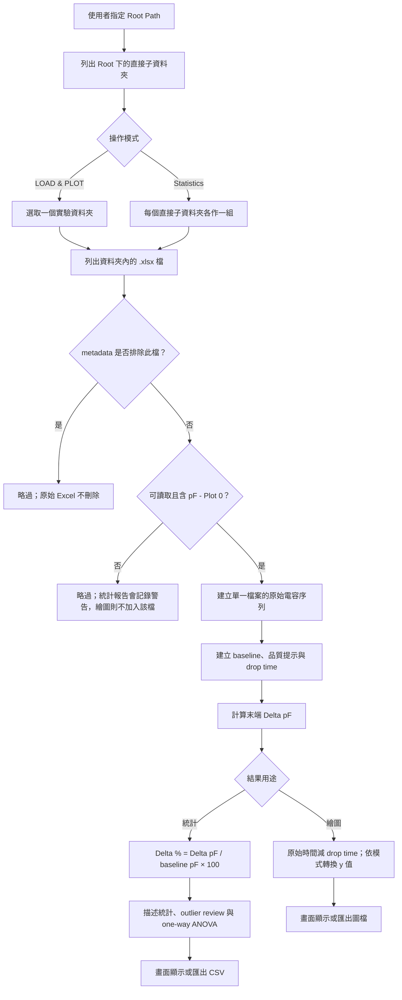
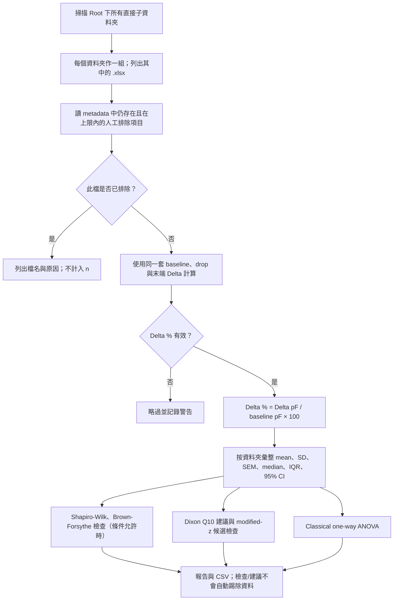

# 皮膚電容分析流程說明

> 本文對應原 Skin Analysis 流程。CAP-S 專用的平均曲線、SD／SEM 陰影與匯出規則，請見 [`cap-s-studio/ANALYSIS_METHOD.md`](./cap-s-studio/ANALYSIS_METHOD.md)。

這份文件說明此工具如何分析實驗資料，適合用來審閱計算步驟、公式與結果限制。內容以目前主要維護的 Python/Tkinter 版本（`Python version/`）為準；同一 repository 內的 `desktop-tauri/` 是另一個實作版本，若要使用該版本作正式報告，應另外核對兩者輸出是否一致。

本文描述的是「程式依照目前程式碼會怎麼算」，不是儀器校正證明，也不是實驗結果的獨立科學驗證。每個結果仍須符合實際量測條件、實驗設計與下文列出的假設。

## 分析目標

此工具用來比較不同實驗檔案中的電容變化。每一個 `.xlsx` 檔案代表一條量測訊號，程式會先建立該檔案自己的 baseline，再找出疑似施藥後的反應起點，也就是 drop time，最後把所有曲線對齊到同一個反應時間點，方便比較不同 sample 的變化。

主要分析結果包含：

- 初始 baseline 平均電容
- drop time，也就是反應起點
- 末端平均電容與 baseline 的差值
- normalized 百分比變化
- baseline 是否可能不穩定
- drop time 是否來自指定施藥時間窗，或是 fallback 自動搜尋

## 一頁總覽：資料到結果

繪圖與統計使用同一套單檔訊號處理流程；差別在於繪圖通常處理使用者選取的一個實驗資料夾，統計則掃描 Root Path 下的全部直接子資料夾，並把資料夾名稱當成組別名稱。



圖中的提示、候選異常值與 Dixon Q 建議都不會自行修改原始數據，也不會自動把 sample 移出主要統計；是否排除由使用者依事先訂好的實驗規則決定。

## 輸入資料格式

程式把選定根目錄下的每個直接子資料夾視為一組實驗。每組實驗資料夾內可以放多個 `.xlsx` 檔案，每個檔案會獨立分析。

資料範例：

```text
ROOT/
  Experiment A/
    1.xlsx
    2.xlsx
    .skin_analysis_metadata.json
  Experiment B/
    1.xlsx
    2.xlsx
```

每個 Excel 檔案必須包含欄位 `pF - Plot 0`。這一欄會被視為原始電容訊號，單位是 pF。

如果檔案無法讀取、沒有這個欄位，或資料是空的，該檔案會被略過，不會進入繪圖。

每組實驗資料夾也可以在 `.skin_analysis_metadata.json` 中保存人工踢除清單。清單只記錄 `.xlsx` 檔名與原因，不會刪除或改名原始檔案。

## 時間軸假設

程式目前假設資料點的取樣間隔是 `0.1` 秒。也就是說：

- 第 1 筆資料時間為 0 秒
- 第 2 筆資料時間為 0.1 秒
- 第 101 筆資料時間約為 10 秒

所有秒數設定，例如 baseline duration、drug apply time、apply window，都會用這個 0.1 秒間隔轉成資料點數。

目前預設值與用途如下。這些參數可在 GUI 的 Timing Parameters 調整，設定只保留在本次程式執行期間，不會寫入 metadata 或統計 CSV；要重現分析，請另外記下實際使用值。

| 設定 | 預設值 | 用途 |
|---|---:|---|
| Sample interval | 0.1 秒（固定假設） | 把資料點索引轉成秒；程式不會從 Excel 自動讀取實際時間欄位 |
| Baseline Duration | 20 秒 | baseline 目標長度；預設換算為 200 點 |
| Drug Apply Time | 25 秒 | 預期施藥時間中心 |
| Apply Window +/- | 5 秒 | 在施藥時間中心前後搜尋；預設搜尋 20–30 秒（含端點） |
| Baseline Accuracy Threshold | 2% | baseline 尾端偏移與連續上升的提示門檻 |

GUI 會拒絕 baseline 時長小於或等於 0、施藥時間或容差小於 0、警示門檻小於 0 的設定。秒數轉點數使用 Python `round`；剛好落在半點時依 Python 的 round 規則處理。baseline 至少保留 1 點。

## Baseline 的建立

每個檔案會先用訊號開頭的一段資料建立自己的 baseline。預設 baseline duration 是 20 秒。

baseline 的用途有三個：

1. 作為該 sample 的初始電容基準。
2. 作為 normalized 顯示模式中的 100% 參考值。
3. 作為 drop 偵測門檻的計算基礎。

baseline 平均值是 baseline 視窗內所有電容值的平均。這個值在圖例中顯示為 `Base`。

如果使用者設定的 baseline duration 太長，導致 baseline 視窗與施藥搜尋區間重疊，程式會自動縮短 baseline，讓 baseline 停在施藥搜尋區間之前。這樣可以避免把施藥反應混入初始基準。

更精確地說，程式取序列開頭的 `N` 點，`N = min(資料總點數, max(1, round(max(baseline 秒數, 0.1) / 0.1)))`。若這個長度會碰到施藥搜尋區間起點，則縮短到該起點索引之前；程式採用 Python 的半開區間，所以 baseline 點是 `0` 至 `N-1`，搜尋從索引 `N` 開始。若資料本身比要求的 baseline 短，整段資料都會成為 baseline，後面可能沒有可分析的反應段。

```text
baseline 平均值 = mean(baseline 內所有電容值)
baseline 標準差 = sample SD（ddof = 1）；只有 1 點時設為 0
drop threshold = baseline 平均值 + 3 × max(baseline 標準差, 0.0001 pF)
```

## 施藥時間窗與 Drop 偵測

工具有兩個重要時間設定：

- `Drug Apply Time (s)`：使用者預期施藥大約發生的時間，預設 25 秒。
- `Apply Window +/- (s)`：允許搜尋 drop 的前後時間範圍，預設正負 5 秒。

例如預設設定下，程式會優先在 20 秒到 30 秒之間找反應起點。

drop 偵測的門檻由 baseline 計算：

```text
drop threshold = baseline 平均值 + 3 * baseline 標準差
```

如果 baseline 的標準差非常小，程式會使用一個極小的最低值，避免門檻變得不合理。

程式會從 baseline 結束後，以及施藥搜尋區間開始後，兩者較晚的時間點開始搜尋。程式採用嚴格大於（`>`）門檻的第一個資料點作為 drop time。雖然介面與變數名稱使用 `drop`，目前實際演算法偵測的是「電容向上超過門檻」，不是向下掉落；若反應方向是下降，這套規則不會辨識該下降為 drop。

```mermaid
flowchart TD
    A[從有效 baseline 算平均值與 sample SD] --> B[門檻 = 平均值 + 3 × max(SD, 0.0001 pF)]
    B --> C[搜尋起點 = baseline 結束與施藥窗起點中較晚者]
    C --> D[在施藥時間窗內找第一個 raw 值 > 門檻]
    D --> E{找到嗎？}
    E -->|是| F[該點時間 = drop time；來源標記 window]
    E -->|否| G[從 baseline 結束後再搜尋最多 500 點：約 50 秒]
    G --> H{fallback 找到 > 門檻的點嗎？}
    H -->|是| I[該點時間 = drop time；來源標記 fallback_auto 並警告]
    H -->|否| J[drop time 設為 baseline 結束點；標記 fallback_auto 並警告]
    F --> K[用 drop time 對齊繪圖，或計算統計 endpoint]
    I --> K
    J --> K
```

## Fallback 自動搜尋

如果程式在使用者指定的施藥時間窗內找不到超過門檻的資料點，就會啟用 fallback 自動搜尋。

fallback 會從 baseline 結束後開始，往後最多搜尋 500 個資料點。因為每點間隔 0.1 秒，所以最多約 50 秒。

如果 fallback 也找不到超過門檻的點，程式仍會把 drop time 設為 baseline 結束時間。這個時間是讓後續運算有參考起點的 fallback 值，不代表程式確認了反應真的在該時間發生。

當使用 fallback 時，工具會顯示 timing warning，提醒這條曲線的 drop time 不是在指定施藥時間窗內找到的。這不代表資料一定錯誤，但代表使用者應該人工確認施藥時間或訊號形狀。

## Delta 的計算

每條曲線的 delta 使用末端平均電容減去 baseline 平均電容：

```text
delta = 最後 100 個資料點的平均電容 - baseline 平均電容
```

如果資料少於 100 點，程式目前不計算有效的末端平均，因此 delta 會是無效值。

統計分析再把此值除以同一檔案的 baseline，轉成百分比。baseline 絕對值小於 `1e-12` 時，統計用的 `Delta %` 會視為無效並略過；圖表 Normalized 模式直接除以 baseline，接近零的 baseline 會造成不適合解讀的比例值。

Delta 的取樣範圍固定是整段紀錄的最後 100 點，不會跟著偵測到的 drop time 移動；drop time 主要用於時間軸對齊與 timing warning。

### 數值例子

假設一個檔案的 baseline 平均值為 `10.0 pF`、sample SD 為 `0.2 pF`：

1. Drop threshold = `10.0 + 3 × 0.2 = 10.6 pF`。
2. 若預設 20–30 秒搜尋窗內第一個高於 `10.6 pF` 的點在 `24.3 秒`，則 drop time = `24.3 秒`。
3. 若最後 100 點平均為 `12.0 pF`，Delta pF = `12.0 - 10.0 = 2.0 pF`。
4. 統計 endpoint Delta % = `2.0 / 10.0 × 100 = 20%`。
5. 繪圖的相對時間為 `原始時間 - 24.3 秒`，所以偵測點顯示在 `0 秒`。

在 raw 顯示模式中，delta 以 pF 顯示。在 normalized 顯示模式中，delta 會轉成相對 baseline 的百分比變化。

## 圖表時間對齊方式

每條曲線偵測到 drop time 後，繪圖時會把 drop time 對齊到 0 秒。

也就是說，圖上的時間軸不是原始量測時間，而是相對於反應起點的時間：

```text
圖上時間 = 原始時間 - drop time
```

這樣做的目的是讓不同 sample 的反應起點重疊，方便比較反應前後的形狀與幅度。

如果開啟 `Show Drop Lines`，圖上的垂直線會出現在 0 秒位置，代表各曲線對齊後的 drop 參考點。

## 顯示模式

### Normalized (%)

這是預設顯示模式。每條曲線會用自己的 baseline 平均值當作 100%。

```text
normalized value = 原始電容 / baseline 平均電容 * 100
```

這個模式適合比較不同 sample 的相對變化，尤其當不同檔案的初始電容值不完全相同時。

### Raw Data (pF)

這個模式顯示原始電容值，單位是 pF。時間軸仍然會以 drop time 對齊到 0 秒。

這個模式適合檢查實際電容大小、雜訊程度、漂移情況，以及偵測到的 drop 是否合理。

### Baseline Only (Raw Baseline Window)

這個模式只顯示 baseline 視窗內的原始資料。它主要用來檢查 baseline 是否穩定。

雖然只顯示 baseline 區段，時間軸仍然使用 drop time 對齊後的相對時間。

## Baseline 穩定度警示

程式會檢查 baseline 是否可能不穩定。預設警示門檻是 2%。

目前有兩種 baseline 警示判斷：

1. 尾端均值偏移：取 baseline 最後 20 個資料點的平均，和整段 baseline 平均比較。如果偏移幅度達到門檻，就標記警示。
2. 連續上升：對 baseline 做 5 點 rolling mean，若至少 10 個連續 rolling-mean 值嚴格遞增（即至少 9 次相鄰上升），且該段結束時的正向偏移達到門檻，就標記警示。此規則只找上升，不找持續下降。

兩種偏移百分比都以 baseline 全段平均值作分母：`offset % = (檢查值 / baseline 平均值 × 100) - 100`。尾端規則在 `abs(offset %) >= 門檻` 時觸發；上升規則則比較連續上升段的正向最大偏移，達到門檻時觸發。

警示狀態分為：

- `ok`：沒有觸發警示。
- `warning`：觸發其中一種 baseline 警示。
- `inaccurate`：兩種 baseline 警示都觸發。

這些警示只提醒使用者注意資料品質，不會自動排除檔案，也不會改變 normalized 的 baseline 定義。

尾端檢查固定使用 baseline 最後最多 20 點；連續上升檢查使用 5 點 rolling mean。程式的最小連續段長設定為 10 個 rolling-mean 值；目前計數方式代表至少 9 次相鄰的嚴格上升。`[注意]` 和 `[不準確]` 是這兩項規則的標籤，不是量測準確度的校正值，也不是統計顯著性判定。

若 baseline 平均值絕對值小於 `1e-12`，目前偏移百分比 helper 會回傳 0，因此 baseline 漂移規則不會因百分比偏移觸發警示；這種接近零的 baseline 本身仍應人工檢查。

在圖例中，可疑資料會加上 `[注意]` 或 `[不準確]`。程式也會跳出警示視窗列出受影響的 sample 與原因。

## 手動踢除 sample

工具支援由使用者人工選定要排除的 `.xlsx` sample。這個功能只會讓該檔案不進入繪圖與統計分析，不會修改原始 Excel 檔。

排除上限依目前實驗資料夾中存在的 `.xlsx` 檔案總數決定，包含之後可能因格式或內容錯誤而分析失敗的檔案：

```text
n < 5: 0
n >= 5: floor(n / 5)
```

例如 `n=5` 到 `n=9` 最多可排除 1 筆，`n=10` 到 `n=14` 最多可排除 2 筆。這個上限是人工品質判斷的保護欄，不代表程式自動判定 outlier。

採用這個設計的原因是，多數正式報告規範會要求事先定義排除標準，並回報每組實際排除的資料與最後分析的 `n`。ARRIVE guideline 要求說明 inclusion/exclusion criteria、逐組回報未納入分析的資料點及原因，並回報每組確切 `n`；GraphPad Prism 說明 outlier identification 沒有單一通用標準，Grubbs 偏向單一 outlier，ROUT 才支援多筆；NIST generalized ESD 也要求先指定最多可能 outlier 數量。參考來源：

- ARRIVE 3a: https://arriveguidelines.org/arrive-guidelines/inclusion-and-exclusion-criteria/3a/explanation
- ARRIVE 3b: https://arriveguidelines.org/arrive-guidelines/inclusion-and-exclusion-criteria/3b/explanation
- ARRIVE 3c: https://arriveguidelines.org/arrive-guidelines/inclusion-and-exclusion-criteria/3c/explanation
- GraphPad outlier guide: https://www.graphpad.com/guides/prism/8/statistics/stat_how_to_removing_outliers.htm
- GraphPad ROUT method: https://www.graphpad.com/guides/prism/latest/statistics/stat_how_it_works_rout_method.htm
- NIST generalized ESD: https://www.itl.nist.gov/div898/handbook/eda/section3/eda35h3.htm

## 圖例與標題

每條曲線的 sample 名稱來自 Excel 檔名，不包含副檔名。例如 `1.xlsx` 會顯示為 `N 1`。

如果使用詳細圖例，圖例可以顯示：

- baseline 平均值
- delta
- baseline 品質標記

圖表標題會使用實驗資料夾名稱，並附上使用者輸入的藥品名稱與劑量。藥品資訊來自該實驗資料夾中的 `.skin_analysis_metadata.json`。

藥品名稱與劑量只用於標題、圖例及人工辨識，不會參與 baseline、drop time、Delta、分組或 ANOVA 的計算。統計組別完全由 Root Path 下的資料夾名稱決定。

## 疊圖與顏色

工具可以把多次載入的實驗疊在同一張圖上。開啟 overlay mode 時，新的曲線會保留既有圖上的曲線，方便跨實驗比較。

如果開啟 experiment color，同一次載入的實驗會使用同一組顏色，不同 sample 用不同線型區分。這有助於從圖上分辨不同實驗來源。

## 統計分析方法

統計分析使用 `Delta %` 作為主要 endpoint。程式把每一個 `.xlsx` 檔案當作一個 sample；若實驗設計是一檔對應一片獨立電極片，就能用每片自己的 baseline 做標準化。程式本身不會驗證電極片是否獨立或是否存在重複量測：

```text
Delta % = delta pF / baseline pF * 100
```

統計視窗會掃描目前 root path 底下的所有直接子資料夾。每個子資料夾會被視為一個濃度組，資料夾名稱就是濃度標籤。



手動踢除的 sample 不會進入 `Delta %`、描述統計或 one-way ANOVA。統計視窗與 CSV 會列出被排除的檔名與原因；描述統計中的 `n` 是排除後實際納入分析的 sample 數。

工具也支援 Dixon's Q `Q10` test 作為明確的單一異常值建議。Dixon Q 只在每組納入分析後 `n=3` 到 `n=10` 時執行，並且只檢查排序後的最低值與最高值：

```text
Q = gap / range
```

其中 `gap` 是可疑端點和最近鄰資料點的距離，`range` 是該組最大值與最小值的距離。這版使用 `α=0.05` 的內建 critical value table，數值參考 [LibreTexts Dixon's Q-Test critical values](https://chem.libretexts.org/Ancillary_Materials/Reference/Reference_Tables/Analytic_References/Appendix_06%3A_Critical_Values_for_Dixons_Q-Test)。如果 `Q > Qcritical`，程式會列出 `Recommended Dixon Exclusions`，並在 Statistics 報告中提供「排除 Dixon 建議樣本後」的 ANOVA sensitivity preview。這個 preview 不會自動改 metadata；使用者仍需在 `Sample Exclusion` 中確認並保存原因。

一般人工排除規則仍是 `n < 5` 不排除、`n >= 5` 最多 `floor(n / 5)`。唯一例外是 `n=3` 或 `n=4` 且 Dixon Q 通過 `α=0.05` 時，工具允許保存一筆 `method=dixon_q` 的排除紀錄。

統計視窗也會做 `Outlier Review`，但這不是自動踢除規則。程式只在每組納入分析後 `n >= 5` 時，對每一筆 `Delta %` 用同組其他 sample 計算 leave-one-out median 與 MAD，再計算：

```text
modified z = 0.6745 * (Delta % - peer median) / peer MAD
```

如果 `abs(modified z) >= 3.5`，該 sample 會被列為候選 outlier，提醒使用者回頭檢查原始曲線、baseline/timing warning 與實驗紀錄。候選樣本不會自動排除，也不會寫入 metadata；只有使用者在 `Sample Exclusion` 手動排除時，才會保存排除原因。

每個濃度組會列出描述統計：

- sample 數量 `n`
- mean、SD、SEM
- median、IQR
- 95% confidence interval

其中 SD 使用 sample standard deviation（`ddof=1`）；SEM = `SD / sqrt(n)`；95% CI 是各組平均值的 t 信賴區間（自由度 `n-1`，需 SciPy 且 `n >= 2`）。Q1、Q3 使用 NumPy 預設的百分位數算法，IQR = `Q3 - Q1`。

```text
mean = sum(x_i) / n
sample SD = sqrt(sum((x_i - mean)^2) / (n - 1))
SEM = sample SD / sqrt(n)
95% CI = mean ± t(0.975, df=n-1) × SEM
```

組間比較使用 one-way ANOVA。這個檢定用來判斷所有濃度組的平均 `Delta %` 是否存在整體差異，也就是是否至少有一個濃度組的平均值和其他組不同。

one-way ANOVA 會列出：

- F 值
- between-groups 與 within-groups 自由度
- p-value
- eta-squared
- omega-squared

程式計算的是 classical one-way ANOVA：先計算組間均方與組內均方，`F = MS_between / MS_within`，再用 F 分布計算 p-value。若組內變異為 0，F 與 p-value 不提供；若沒有 SciPy，F 和 effect size 仍可能計算，但 p-value、95% CI 與檢查檢定不可用。

效應量的程式公式為：`eta² = SS_between / SS_total`；`omega² = max(0, (SS_between - df_between × MS_within) / (SS_total + MS_within))`。其中 `SS_total = SS_between + SS_within`。這兩個數值描述組別在觀察到的總變異中所占比例的估計，不會取代 p-value 或實驗設計判斷。

此檢定的 p-value 依賴獨立樣本、各組分布大致符合常態，以及組間變異數相近等假設；[SciPy 的 one-way ANOVA 說明](https://docs.scipy.org/doc/scipy/reference/generated/scipy.stats.f_oneway.html)也列出這些條件。工具把每個 `.xlsx` 當成一個 sample，但無法確認同一電極、同一批次或重複量測是否造成樣本相依。Brown-Forsythe（程式以 median-centered Levene 檢定實作）與 Shapiro-Wilk 只提供診斷資訊；結果不會自動改用 Welch ANOVA、其他檢定或排除資料。[SciPy 對 median-centered Levene/Brown-Forsythe 的說明](https://docs.scipy.org/doc/scipy/reference/generated/scipy.stats.levene.html)。

這版統計分析只包含 one-way ANOVA，不包含兩兩比較或事後比較。如果 ANOVA 顯著，只能說明濃度組之間存在整體差異；若需要判斷哪兩組不同，應依課程或實驗規範另行決定是否做事後比較。

統計視窗也會顯示假設檢查：

- Shapiro-Wilk normality check：每組 `n >= 3` 時執行。
- Brown-Forsythe variance check：至少兩組各有 `n >= 2` 時執行。

如果 `scipy` 未安裝，描述統計與 ANOVA 的 F 值仍可顯示，但 p-value、95% confidence interval 與假設檢查會標示為不可用。若樣本數太少，例如某組 `n < 2` 或 `n < 3`，工具會顯示警示並略過不適合的推論統計。

統計流程會保留資料夾作為組別，即使資料夾沒有可分析的檔案也會列出警告。ANOVA 只使用 `n >= 2` 的組；至少要有兩組各 `n >= 2` 才計算。Dixon Q 與 modified-z 是額外的人工審查資訊，與主要 ANOVA 分開呈現。

## 結果判讀建議

分析結果應搭配原始曲線形狀一起判讀，不建議只看單一數值。

建議優先確認：

1. baseline 區段是否平穩。
2. drop time 是否落在預期施藥時間附近。
3. 是否出現 fallback timing warning。
4. normalized 曲線是否因 baseline 太小或不穩而被放大。
5. delta 是否代表實驗真正想比較的末端狀態。

如果資料出現 `[注意]` 或 `[不準確]`，建議切換到 raw 或 baseline only 模式檢查該 sample，再決定是否納入解讀。

## 目前分析限制

目前程式採用固定取樣間隔 0.1 秒，而且不讀取或驗證 Excel 中的實際時間欄位。如果原始資料取樣間隔不是 0.1 秒，時間軸、baseline 長度、施藥搜尋窗與 fallback 長度都會不準。

目前所稱的 drop 偵測實際上是「電容首次嚴格高於 baseline 平均值加 3 倍標準差」。若訊號反應方向是下降、雜訊造成過早 crossing、或施藥前已有漂移，偵測時間可能不準。若指定時間窗與 fallback 都沒有 crossing，fallback 仍會回傳 baseline 結束點，因此該時間不可解讀為已確認反應起點。

Delta 使用最後 100 個資料點的平均，因此描述的是量測末端狀態，不一定代表最大反應、反應速度或曲線下面積。少於 100 點時 Delta 無效；baseline 接近 0 時，統計 Delta % 無效，Normalized 繪圖也不適合解讀。

程式沒有替原始資料做插值、平滑或通用缺值清理。baseline 使用一般 mean/SD；若 baseline 區段含 NaN，baseline 平均與標準差可能變成 NaN，造成 crossing 無法判定。末端平均使用 `nanmean`，但若末端資料全為缺值，Delta 仍無效；不可轉成數字的欄位值也可能使整次載入或統計工作失敗。應先檢查 Excel 中的缺值與非數值資料。

baseline 警示是品質提示，不是統計檢定。它能幫助找出明顯漂移或上升的 baseline，但不能保證沒有警示的資料一定完全可靠。

統計 CSV 與 metadata 不會保存本次 baseline、施藥時間與容差等 session-only 設定。正式記錄時應一併保存這些參數、程式版本、原始檔與排除理由，否則僅靠 CSV 不一定能完整重現分析。one-way ANOVA 只檢查整體組別差異，不含兩兩事後比較；顯著結果不能單獨證明藥物造成因果效果。

## 可信度與適用範圍

可把「可信任」拆成三個不同問題：

| 問題 | 本工具能提供什麼 | 仍需由研究者確認什麼 |
|---|---|---|
| 公式是否清楚、能否重算？ | baseline、threshold、Delta、Delta % 與 ANOVA 都有明確公式；相同資料、版本與設定可依相同步驟重算 | 設定目前不隨 CSV 保存，須自行記錄；外部套件版本也可能影響統計結果末位數 |
| 原始量測是否正確？ | 檢查指定欄位、提供 baseline/timing 警告與 raw plot | 儀器校正、電極接觸、單位、真實取樣率、實驗操作與資料是否完整 |
| 統計結論是否有效？ | 提供描述統計、假設檢查、ANOVA 與候選異常值報告 | 樣本是否獨立、分組是否正確、樣本數是否足夠、ANOVA 假設是否合理，以及研究問題是否適合此 endpoint |

專案測試包含合成訊號的 baseline、drop、fallback、Delta 與警示案例、統計公式案例，以及共用的 Excel parity fixture。這些測試能檢查「程式是否按預期計算」，但不等同於用校正標準品驗證儀器，也不等同於用代表性真實資料完成演算法效度研究。較準確的定位是：本工具是可追溯計算與人工資料品質審查的輔助工具；它不能單獨證明量測正確、分析方法已被外部驗證，或實驗假設成立。

### 提交結果給老師前，建議一併交代

- 原始資料夾結構，以及每個子資料夾如何對應實驗組別。
- 實際取樣間隔是否確認為 0.1 秒；實際使用的 baseline 秒數、施藥時間、容差與警示門檻。
- 每組 `.xlsx` 總數、納入統計的 `n`、排除檔案與原因，以及 baseline/timing 警告。
- 代表性 Raw Data 與 baseline 圖，並確認 drop time 符合實驗記錄。
- 使用的程式版本與 SciPy 是否可用；若報告 ANOVA p-value，說明樣本獨立性及變異數/分布假設如何評估。

## 建議人工檢查流程

1. 先用 `Normalized (%)` 查看整體相對變化。
2. 查看圖例是否有 `[注意]` 或 `[不準確]`。
3. 如果有警示，切到 `Baseline Only (Raw Baseline Window)` 檢查 baseline。
4. 切到 `Raw Data (pF)` 確認實際電容值與 drop 位置。
5. 檢查 timing warning，確認 drop 是否真的落在施藥時間窗內。
6. 最後再根據實驗設計判斷是否採用該 sample 的 delta 或 normalized 變化。
